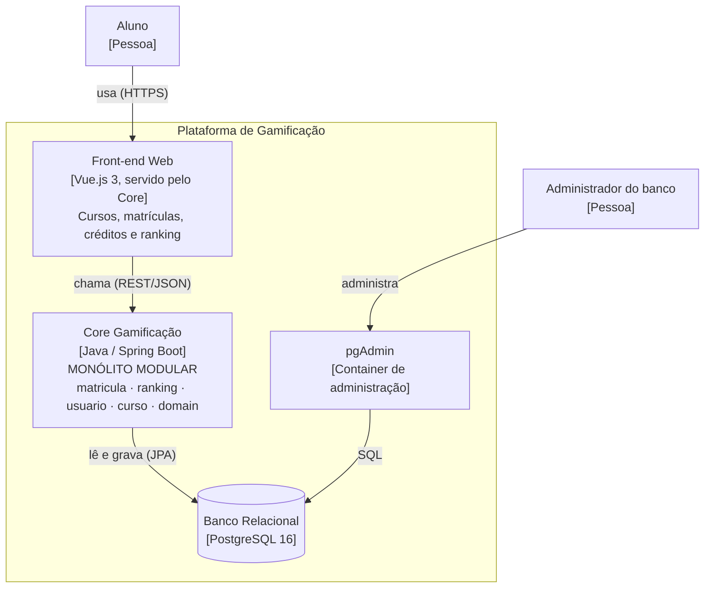
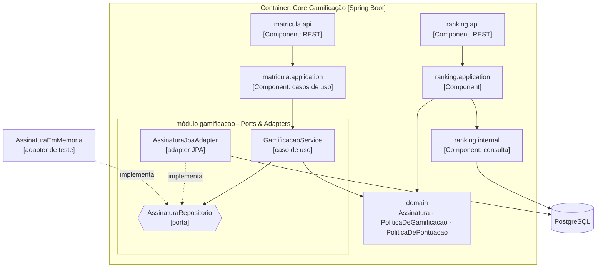
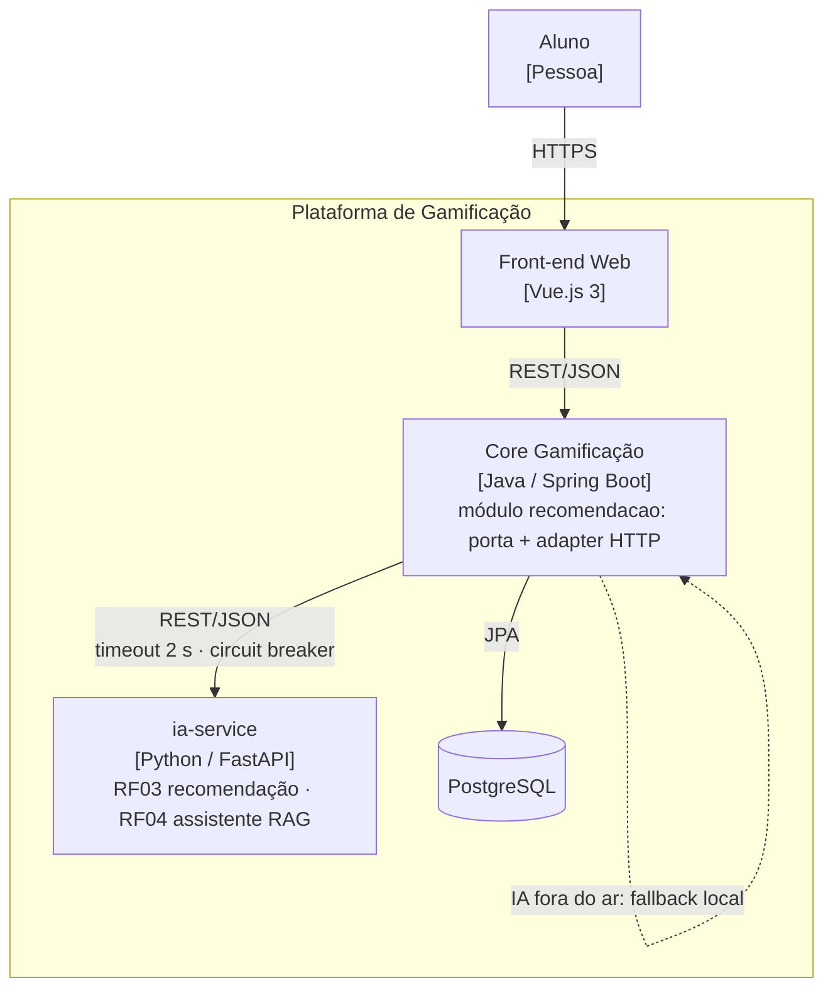
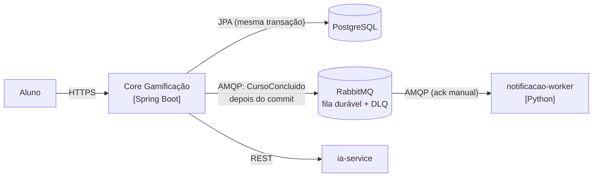
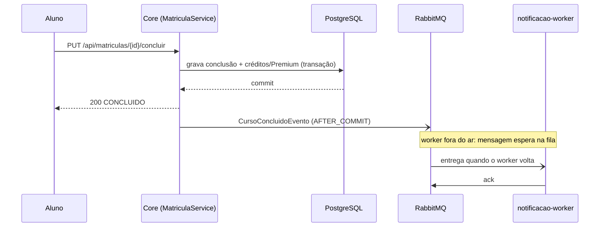

# AC2 - B1 Architecture Lab - Grupo 7

Registro arquitetural vivo da AC2 (Exercício B1 - Architecture Lab). O produto é o MVP de
**Gamificação para Educação Continuada** construído na AC1. No B1 ele passa a receber crescimento
de usuários, IA, eventos, IoT e exigências de operação. Em cada desafio a equipe assume o papel de
Tech Lead e justifica a decisão antes de mexer no código, seguindo sempre a mesma cadeia:

```
RF → RNF → ASR + RPC → alternativas/trade-offs → ADR → C4 → evidência
```

## Equipe

- Matheus de Alcantara
- Rafael Silva Fiamengue
- Henrique Bicudo Paulino

### Papéis por desafio

| Desafio | Mini-lab (código + evidência) | Decisão + ADR | C4 |
|---|---|---|---|
| D1 - Drivers e evolução do Core | Matheus | Rafael | Henrique |
| D2 - Organização interna do Core | Rafael | Henrique | Matheus |
| D3 - Serviço Python e IA | Henrique | Matheus | Rafael |
| D4 - Comunicação e eventos | Rafael | Henrique | Matheus |
| D5 - IoT e MQTT | Henrique | Matheus | Rafael |
| D6 - CI/CD e observabilidade | Matheus | Rafael | Henrique |

## Ponto de partida: o legado da AC1

Este repositório começou como cópia do repositório da AC1
([malcantara-dev/devops-ac1-atdd](https://github.com/malcantara-dev/devops-ac1-atdd)), com todo o
histórico. A tag `ac1-final` marca exatamente o estado entregue na AC1, que é o "antes" de todas as
decisões abaixo. A documentação original da AC1 (User Stories, BDD, TDD e evidências) foi movida
para [docs/ac1/README.md](docs/ac1/README.md).

O que o legado entrega hoje:

- Spring Boot 4.1 (Java 17) organizado em camadas técnicas: `controller`, `service`, `repository`,
  `entity`, `dto` e `config`.
- Um pacote `domain` puro (sem framework) com as regras nascidas do TDD: crédito de 3 cursos ao
  concluir com nota >= 7, curso em andamento não gera crédito e desbloqueio de curso bônus
  consumindo crédito (cenários 1 a 6, cobertura de 100% no `domain`).
- API REST com Swagger, front-end em Vue.js servido pela própria aplicação, H2 para estudo e
  PostgreSQL + pgAdmin via Docker Compose.
- Testes rodando no GitHub Actions a cada push, com relatório do JaCoCo.

---

# Desafio 1 - Drivers e evolução do Core

**Papel: Tech Lead.** Decidir a arquitetura macro do Core antes de decompor o sistema, a partir dos
RFs, RNFs, ASRs e RPCs, comparando alternativas e sustentando a escolha com evidência técnica.

## 1. Leitura do cenário

O MVP da AC1 foi pensado para poucos usuários. No B1 ele cresce de aproximadamente 1.000 para até
**100.000 usuários**. Ranking, cursos, conquistas e recompensas continuam no Core, mas o **Ranking
tende a crescer mais** que as demais capacidades, porque é uma consulta que todo aluno faz com
frequência e que compara todos os alunos entre si.

Hoje o Core é um monólito em camadas técnicas. Cada capacidade de negócio fica espalhada pelas seis
camadas: para entender ou mudar a matrícula, por exemplo, é preciso passar por `controller`, `dto`,
`service`, `entity`, `repository` e `domain`. Isso funcionou bem para o tamanho da AC1, mas é o
ponto que mais pesa quando o produto começa a crescer de forma desigual.

> **Pergunta do Tech Lead:** há evidência suficiente para introduzir distribuição e deploy
> independente agora, ou uma modularização interna resolve o problema com menor custo operacional?

A decisão não parte da tecnologia desejada, e sim dos drivers que realmente justificam mudança
estrutural.

## 2. RFs afetados

| ID | Requisito funcional | Situação no legado | Impacto no desafio |
|---|---|---|---|
| RF01 | Ranking de alunos | Não existe na AC1 | Capacidade nova e com carga que tende a crescer mais; precisa nascer com fronteira clara e ser mensurável. |
| RF02 | Conquistas / gamificação | Parcial: créditos por conclusão e desbloqueio bônus (cenários 1, 2, 5 e 6). Premium após 12 cursos e moedas ainda não existem | As regras de créditos, Premium, moedas e recompensas continuam evoluindo e precisam de fronteiras claras. |
| - | Funcionalidades existentes: matrícula, conclusão, nota parcial, desbloqueio | Implementadas em camadas | Precisam continuar funcionando sem mudança de comportamento durante a evolução. |

## 3. RNFs e seleção dos ASRs

Nem todo RNF é automaticamente um ASR. Foram selecionados apenas os atributos capazes de mudar a
estrutura, a implantação ou a operação do Core (máximo de 3).

| RNF (FURPS+) | ASR? | Justificativa arquitetural |
|---|---|---|
| Manutenibilidade (Supportability) | **SIM** | As capacidades evoluem em ritmos diferentes: Ranking é novo, a gamificação vai ganhar Premium e moedas, a matrícula está estável. Com a organização por camada técnica, qualquer mudança atravessa seis pacotes. Fronteiras por capacidade mudam a **estrutura** do código e reduzem o impacto de cada mudança. |
| Escalabilidade (Performance) | **SIM** | O Ranking tem crescimento de carga diferente das demais capacidades e pode exigir estratégia própria no futuro (cache, réplica de leitura ou extração). Isso pode mudar a **implantação**, então a fronteira do Ranking precisa existir desde já. |
| Complexidade operacional (+ restrição de equipe) | **SIM** | Uma equipe de 6 pessoas teria de absorver vários deploys, rede, contratos, observabilidade e falhas distribuídas se serviços fossem criados agora. Isso muda a **operação** e é o principal freio à distribuição. |
| Desempenho (Performance) | NÃO, neste momento | É relevante, mas a AC1 nunca mediu latência nem throughput e o cenário não traz nenhuma medição que prove gargalo arquitetural. Sem medição, não há como ele dirigir a decisão. |
| Testabilidade (Supportability) | NÃO como driver macro | É importante e vai melhorar com a modularização (testes por capacidade), mas sozinha não determina a decomposição. O `domain` já tem 100% de cobertura; o que falta são testes das camadas de aplicação, o que não exige mudar a arquitetura macro. |

## 4. RPCs - restrições e premissas

| RPC | Consequência para a decisão |
|---|---|
| Core atual em Java/Spring Boot (Spring Boot 4.1, Java 17, build e CI com JDK 21) | A evolução deve preservar o investimento e o legado existentes. |
| Equipe de 6 desenvolvedores | A solução deve manter a complexidade operacional proporcional à capacidade da equipe. |
| Banco relacional existente (PostgreSQL 16, com H2 para estudo) | Não há justificativa, neste desafio, para trocar a tecnologia de dados apenas por modernização. |
| Legado da AC1: `domain` puro coberto 100% por TDD (cenários 1 a 6) | A solução deve evoluir de forma incremental, sem reescrita integral e sem quebrar os testes que provam as regras de negócio. |
| Um único Docker Compose (app + PostgreSQL + pgAdmin) e um pipeline no GitHub Actions | Qualquer novo processo implantável aumenta diretamente o custo de build, deploy e operação. |

## 5. Alternativas e trade-offs

| Alternativa | Benefícios | Custos / riscos | Avaliação |
|---|---|---|---|
| A - Monólito em Camadas (manter a AC1) | Nenhum custo de mudança; baixa complexidade operacional; continuidade imediata. | A organização por camada técnica espalha cada capacidade em seis pacotes e tende a aumentar o acoplamento entre capacidades conforme o produto cresce. O Ranking nasceria misturado às demais. | Possível, mas pouco preparada para a evolução prevista. |
| B - Monólito Modular | Fronteiras por capacidade; continua um único jar, um container, um banco e um pipeline; facilita testes, manutenção e futura extração seletiva. | Reorganização de pacotes; ainda compartilha processo de execução, banco e deploy; fronteiras precisam ser verificadas para não virarem só pastas. | Melhor equilíbrio entre os ASRs e as RPCs. |
| C - Serviços independentes (ex.: Ranking como microsserviço) | Permite escala e deploy independentes por capacidade. | Rede, contratos entre serviços, observabilidade distribuída, tolerância a falhas, consistência de dados entre bancos e maior custo operacional para a equipe. | Prematura sem evidência de necessidade de independência. |

## 6. Decisão do Tech Lead

> **DECISÃO: evoluir o Core para um MONÓLITO MODULAR, de forma incremental.**

O Core continua sendo uma única aplicação Spring Boot, mas passa a ser organizado por capacidade de
negócio. A evolução começa por duas capacidades:

- **Matrícula**, funcionalidade que veio da AC1, é reorganizada como o primeiro módulo
  (`matricula/api`, `matricula/application`, `matricula/internal`), sem mudar comportamento.
- **Ranking (RF01)** já nasce como módulo, com fronteira própria, e é tratado como **candidato
  explícito à extração futura**. Ele não vira microsserviço apenas pela previsão de crescimento.

As demais capacidades (usuário, curso) continuam no formato em camadas e migram quando forem
alteradas. O pacote `domain` da AC1 permanece como núcleo compartilhado, preservando os testes do
TDD.

**Racional:** a modularização atende principalmente manutenibilidade e controle da complexidade
operacional e, ao mesmo tempo, cria uma fronteira adequada para observar o ASR de escalabilidade. A
decomposição em serviço será reavaliada somente se métricas demonstrarem necessidade de escala ou de
deploy independente.

## 7. ADR-001 - Evolução do Core

| Campo | Registro |
|---|---|
| Título | ADR-001 - Evoluir o Core de Monólito em Camadas para Monólito Modular |
| Status | Aceito |
| Contexto | O produto cresce para até 100.000 usuários; o Ranking (RF01) é uma capacidade nova com crescimento de carga diferente; as regras de gamificação (RF02) continuam evoluindo; no legado cada capacidade está espalhada por seis camadas técnicas. |
| ASRs | Manutenibilidade; Escalabilidade; Complexidade operacional. |
| RPCs | Java/Spring Boot; equipe de 6 desenvolvedores; banco relacional PostgreSQL; legado da AC1 com `domain` coberto por TDD; um único Docker Compose. |
| Alternativas | A) Monólito em Camadas; B) Monólito Modular; C) decomposição seletiva em serviços. |
| Decisão | Adotar Monólito Modular de forma incremental: Matrícula vira o primeiro módulo, Ranking nasce módulo e preserva a fronteira para eventual extração futura. |
| Consequências positivas | Melhor separação de responsabilidades; menor acoplamento entre capacidades; evolução incremental sem reescrita; custo operacional igual ao atual e muito menor que o de microsserviços. |
| Trade-offs | Deploy ainda conjunto; processo e banco compartilhados; Ranking ainda não possui escala independente; durante a transição convivem módulos e camadas. |
| Gatilho de revisão | Reavaliar a extração do Ranking quando métricas mostrarem gargalo, necessidade de escala própria ou de deploy independente. |

## 8. C4 - visão de Container

No Desafio 1 a decisão é macro. O C4 Container mostra que o Core continua sendo **um único
container** e explicita que sua organização interna passa a ser modular. O detalhamento dos
componentes internos fica para o C4 Component do Desafio 2.



Impacto da decisão: nenhum container novo foi criado. A mudança é interna ao Core e será detalhada
no C4 Component do Desafio 2.

## 9. Mini-lab - evidência arquitetural

A evidência não é apenas um print da aplicação funcionando. O objetivo é testar a hipótese de que a
modularização torna as fronteiras e dependências mais explícitas **sem alterar o comportamento**.

### 9.1 Estrutura antes (tag `ac1-final`)

```
org/example/grupo_7_praticaatdd/
├── controller/  CursoRestController  MatriculaRestController  UsuarioRestController  ApiExceptionHandler
├── service/     CursoService  MatriculaService  UsuarioService
├── repository/  CursoRepository  MatriculaRepository  UsuarioRepository
├── entity/      CursoEntity  MatriculaEntity  UsuarioEntity
├── dto/         CursoRequestDTO  CursoResponseDTO  MatriculaRequestDTO  MatriculaResponseDTO
│                NotaRequestDTO  UsuarioRequestDTO  UsuarioResponseDTO
├── domain/      Assinatura  Curso  Matricula  StatusMatricula  Usuario
└── config/      OpenApiConfig
```

### 9.2 Dependências antes (medidas com `jdeps`)

Coletado sobre as classes compiladas da tag `ac1-final`. Arquivo completo:
[docs/evidencias/desafio-1/antes-dependencias.txt](docs/evidencias/desafio-1/antes-dependencias.txt).

| De → Para | Pares classe → classe |
|---|---|
| controller → dto | 7 |
| controller → service | 3 |
| service → domain | 5 |
| service → entity | 5 |
| service → repository | 5 |
| service → dto | 3 |
| repository → entity | 3 |
| entity → domain | 1 |

O que os números mostram sobre a capacidade **Matrícula**:

- Ela está espalhada em **9 classes distribuídas em 6 pacotes** (`controller`, `dto`, `service`,
  `entity`, `repository`, `domain`).
- O `MatriculaService` depende diretamente de **3 repositórios e 3 entidades**, incluindo os de
  Usuário e Curso. Nada na estrutura impede que qualquer classe acesse a persistência de outra
  capacidade.

### 9.3 Estrutura depois (resultado do mini-lab)

```
org/example/grupo_7_praticaatdd/
├── matricula/
│   ├── api/                    MatriculaRestController  MatriculaRequestDTO  MatriculaResponseDTO  NotaRequestDTO
│   ├── application/            MatriculaService
│   └── internal/persistence/   MatriculaEntity  MatriculaRepository
├── ranking/
│   ├── api/            RankingRestController  RankingItemDTO
│   ├── application/    RankingService
│   └── internal/       RankingConsulta  AlunoPontuado
├── domain/             núcleo da AC1, compartilhado e coberto por TDD
└── controller/ service/ repository/ entity/ dto/   usuario e curso, ainda em camadas
```

Mapa de pacotes antes e depois, gerado pelo mesmo script (`scripts/dependencias.sh`, com `jdeps`):
[antes-pacotes.txt](docs/evidencias/desafio-1/antes-pacotes.txt) ×
[depois-pacotes.txt](docs/evidencias/desafio-1/depois-pacotes.txt) e
[antes-estrutura.txt](docs/evidencias/desafio-1/antes-estrutura.txt) ×
[depois-estrutura.txt](docs/evidencias/desafio-1/depois-estrutura.txt).

Regras de fronteira verificadas a cada build por `ModulosArchTest` (ArchUnit):

- nenhuma classe fora de `matricula` acessa `matricula.internal`;
- nenhuma classe fora de `ranking` acessa `ranking.internal`;
- `ranking` e `matricula` não dependem um do outro;
- o legado em camadas não chama o `application` dos módulos;
- o `domain` não depende de Spring nem de JPA (`ArquiteturaCamadasTest`).

### 9.4 O que comparar (resultado)

| Evidência | Antes | Depois |
|---|---|---|
| Organização | Matrícula em 6 pacotes técnicos (`controller`, `dto`, `service`, `entity`, `repository`, `domain`). | Matrícula em 1 módulo (`matricula/`) + o `domain` da AC1; Ranking em 1 módulo (`ranking/`). |
| Dependências | Só setas entre camadas; não dá para saber de qual capacidade é cada classe. | Cada seta diz qual módulo usa o quê; não existe seta entre `ranking` e `matricula`. |
| Proteção | Nenhuma: qualquer classe usava qualquer repository. | Acessar o `internal` de outro módulo derruba o build: [violacao-simulada.md](docs/evidencias/desafio-1/violacao-simulada.md). |
| Comportamento | 15 testes verdes, sendo 5 de API da matrícula escritos **antes** da mudança: [antes-testes.txt](docs/evidencias/desafio-1/antes-testes.txt). | Os mesmos testes verdes, mais Ranking e 5 regras de fronteira (23 testes): [depois-testes.txt](docs/evidencias/desafio-1/depois-testes.txt). |
| Infraestrutura | 1 jar, 1 container de aplicação, 1 banco. | Igual: nenhum processo novo. |

### 9.5 Como reproduzir

```bash
# compilar e medir as dependências
./mvnw -q -DskipTests compile
jdeps -verbose:class -filter:none target/classes

# rodar todos os testes (domínio, API e regras de arquitetura)
./mvnw test
```

## 10. Evidências a versionar

| Evidência | Situação |
|---|---|
| README arquitetural com RF → RNF → ASR → RPC → alternativas → decisão | Feito (este documento) |
| ADR-001 com decisão e trade-offs | Feito (seção 7) |
| C4 Container atualizado | Feito (seção 8) |
| Estrutura e dependências **antes** | Feito: [antes-dependencias.txt](docs/evidencias/desafio-1/antes-dependencias.txt) |
| Testes MockMvc da matrícula antes da reorganização | Feito: `MatriculaApiTest` (5 testes) |
| Código da modularização da Matrícula e do módulo Ranking (RF01) | Feito: `matricula/` e `ranking/` com `GET /api/ranking` |
| Estrutura e dependências **depois** + regras ArchUnit | Feito: [depois-pacotes.txt](docs/evidencias/desafio-1/depois-pacotes.txt) e `ModulosArchTest` |
| Testes executados após a refatoração, demonstrando preservação do comportamento | Feito: [depois-testes.txt](docs/evidencias/desafio-1/depois-testes.txt) |

## 11. Conclusão

A equipe decidiu evoluir o Core para Monólito Modular, de forma incremental. A medição do "antes"
confirma o problema que motiva a decisão: a capacidade Matrícula está espalhada em seis pacotes
técnicos e o seu service acessa diretamente a persistência de outras capacidades, sem nenhuma
fronteira que impeça esse acoplamento.

A extração do Ranking para um serviço independente não foi adotada neste momento porque o cenário
informa crescimento, mas ainda não fornece evidência de gargalo nem necessidade comprovada de deploy
independente. Essa decisão deverá ser revisitada quando métricas de carga, latência, throughput ou
frequência de deploy justificarem o custo adicional de distribuição. Essas métricas passam a ser
coletadas no Desafio 6.

O mini-lab confirmou a hipótese. A Matrícula foi reorganizada por capacidade e o Ranking nasceu
como módulo, sem comunicação distribuída e sem mudar o comportamento: os 5 testes de API escritos
antes da mudança passaram iguais depois. A fronteira deixou de ser combinação da equipe e passou a
ser verificada pelo build. Fica como dívida conhecida que o módulo `matricula` ainda usa os
repositórios de usuário e curso do legado; eles migram quando forem alterados.

## 12. Rastreabilidade final

| Elemento | Resposta resumida |
|---|---|
| RF | RF01 Ranking (novo) e RF02 Conquistas (créditos da AC1, Premium e moedas a evoluir). |
| RNF | Manutenibilidade, escalabilidade, testabilidade, desempenho e complexidade operacional foram analisados. |
| ASR | Manutenibilidade, escalabilidade e complexidade operacional. |
| RPC | Spring Boot, 6 desenvolvedores, PostgreSQL, legado da AC1 com `domain` coberto por TDD, um único Docker Compose. |
| Alternativas | Monólito em Camadas × Monólito Modular × serviços independentes. |
| ADR | ADR-001: adotar Monólito Modular de forma incremental. |
| C4 | Core permanece um container; a organização interna passa a ser modular. |
| Evidência | Medição de dependências antes/depois com `jdeps`, regras ArchUnit e testes preservando o comportamento. |

**Regra de leitura:** RF/RNF → ASR + RPC → alternativas → ADR → C4 → evidência.

---

# Desafio 2 - Organização interna do Core

**Papel: Tech Lead.** Proteger o domínio contra dependências técnicas, decidindo qual dependência
precisa ser invertida e se o custo estrutural é proporcional ao problema.

## 1. Leitura do cenário

As regras de ranking, moedas, badges e recompensas mudam com frequência. O B1 acrescenta uma regra
nova ao RF02: **ao concluir o 12º curso com aproveitamento, o plano vira Premium e o aluno recebe 3
moedas**. A equipe precisa evitar que domínio, banco, framework e integrações fiquem acoplados.

Ao tentar implementar a regra, o legado mostrou o problema concreto: o `MatriculaService` da AC1
remontava o domínio só com os créditos (`new Assinatura()` + `adicionarCreditos`). O domínio nunca
sabia quantos cursos o aluno já tinha concluído, então a regra do Premium era impossível de aplicar
pela API, mesmo estando correta nos testes de domínio.

## 2. RFs afetados

| ID | Requisito funcional | Impacto no desafio |
|---|---|---|
| RF01 | Ranking | A fórmula de pontuação passa a considerar moedas e deve mudar em um só lugar. |
| RF02 | Conquistas / gamificação | Premium no 12º curso com 3 moedas; as regras devem ser testáveis sem banco. |

## 3. RNFs e seleção dos ASRs

| RNF | FURPS+ | ASR? | Justificativa arquitetural |
|---|---|---|---|
| Modificabilidade | Supportability | **SIM** | A regra muda com frequência; precisa ficar no domínio, isolada de banco e framework. |
| Testabilidade | Supportability | **SIM** | O caso de uso deve funcionar com qualquer persistência, inclusive em memória. |
| Manutenibilidade | Supportability | **SIM** | A tradução entre tabela e domínio deve morar em um único adapter. |
| Facilidade de evolução | Supportability | NÃO como driver separado | É consequência dos três ASRs acima. |

## 4. RPCs - restrições e premissas

| RPC | Consequência para a decisão |
|---|---|
| Core continua Spring Boot | Ports & Adapters dentro do mesmo processo, com injeção do Spring. |
| Regras existentes devem ser reaproveitadas | Os 6 cenários do TDD da AC1 continuam passando sem alteração. |
| Proibido reescrever o produto para aplicar um padrão | O padrão entra só no módulo de gamificação. |

## 5. Alternativas e trade-offs

| Alternativa | Benefícios | Custos / riscos | Avaliação |
|---|---|---|---|
| A - Estrutura atual (service usa JPA direto) | Nenhum código novo. | A regra do Premium não chega ao domínio; testar exige banco. | Rejeitada: não atende o RF02. |
| B - Ports & Adapters (Hexagonal) no módulo de gamificação | Domínio isolado; mesma regra testada com adapter JPA e em memória; mudança localizada. | Uma interface e um adapter a mais. | **Melhor equilíbrio.** |
| C - Clean Architecture em todo o Core | Regras de dependência uniformes. | Reescrever controllers, services e entidades de todas as capacidades. | Rejeitada: viola a RPC. |

## 6. Decisão do Tech Lead

**DECISÃO: aplicar Ports & Adapters só no módulo de gamificação, combinado com o domínio do DDD.**

- **Qual dependência precisa ser invertida?** A do caso de uso para a persistência. A porta
  `AssinaturaRepositorio` pertence ao caso de uso; o adapter JPA depende dela, nunca o contrário.
- **O custo é proporcional?** Sim: uma interface, um adapter JPA e um adapter em memória para os
  testes. O restante do Core não muda.
- **DDD, Hexagonal, Clean e Onion são concorrentes?** Não, são combináveis. Do DDD vem o domínio
  rico e a linguagem do case (Assinatura, Premium, moedas). Do Hexagonal vêm a porta e os adapters.
  Clean e Onion levariam as mesmas regras a todas as camadas, o que seria desproporcional agora.

## 7. ADR-002 - Ports & Adapters na gamificação

| Campo | Registro |
|---|---|
| Título | ADR-002 - Isolar a gamificação com Ports & Adapters |
| Status | Aceito |
| Contexto | Regras de gamificação mudam com frequência; o Premium exige o estado completo da assinatura, que o service da AC1 não levava ao domínio. |
| ASRs | Modificabilidade; Testabilidade; Manutenibilidade. |
| RPCs | Spring Boot; regras da AC1 reaproveitadas; proibido reescrever o produto. |
| Alternativas | A) service com JPA direto; B) Ports & Adapters na gamificação; C) Clean Architecture no Core inteiro. |
| Decisão | Criar a porta `AssinaturaRepositorio` em `gamificacao.application`, implementada por `AssinaturaJpaAdapter` (`gamificacao.internal.jpa`) e por `AssinaturaEmMemoria` nos testes; regras em `PoliticaDeGamificacao` e `PoliticaDePontuacao` no `domain`. |
| Consequências positivas | Regra do Premium funciona de ponta a ponta; o mesmo contrato roda com os dois adapters; trocar a persistência não muda o caso de uso. |
| Trade-offs | Convivem módulos com porta e legado em camadas; o adapter JPA ainda grava na tabela `usuarios` do legado. |
| Gatilho de revisão | Levar a porta a outros módulos quando eles tiverem regras que mudam com frequência ou precisarem trocar a persistência (ex.: ranking em cache). |

## 8. C4 - visão de Component do Core

A decisão é interna ao Core, então o nível afetado é o Component. As setas mostram o sentido das
dependências: a porta pertence ao caso de uso e o adapter JPA depende dela.



## 9. Mini-lab - evidência arquitetural

**Hipótese:** com a regra no domínio e a persistência atrás de uma porta, o mesmo caso de uso
funciona com qualquer adapter e a regra do Premium passa a valer de ponta a ponta.

| Evidência | Resultado |
|---|---|
| TDD do RF02 (cenários 7 e 8) | [RED](docs/evidencias/desafio-2/tdd/01-red.md) → [GREEN](docs/evidencias/desafio-2/tdd/02-green.md) → [BLUE](docs/evidencias/desafio-2/tdd/03-blue.md), com 100% de cobertura no `domain` ([JaCoCo](docs/evidencias/desafio-2/tdd/jacoco-domain.md)). |
| Troca de adapter | Os mesmos 4 testes do contrato passam com o adapter em memória (0,25 s, sem Spring) e com o JPA (21 s, H2): [contrato-dois-adapters.md](docs/evidencias/desafio-2/contrato-dois-adapters.md). |
| Dependências do caso de uso | `gamificacao.application -> domain` é a única dependência; o JPA só aparece em `gamificacao.internal.jpa`: [depois-pacotes.txt](docs/evidencias/desafio-2/depois-pacotes.txt). |
| Regra de ponta a ponta | `GamificacaoApiTest`: 12 cursos concluídos pela API resultam em plano `PREMIUM` e 3 moedas. |
| Proteção | `ModulosArchTest` derruba o build se `gamificacao.application` importar JPA, entidade ou repository. |

## 10. Evidências a versionar

| Evidência | Situação |
|---|---|
| Regra de domínio isolada (Premium e pontuação) | Feito: `PoliticaDeGamificacao`, `PoliticaDePontuacao` |
| Troca de adapter mantendo os testes do domínio | Feito: `AssinaturaRepositorioContrato` com dois adapters |
| C4 Component | Feito (seção 8) |
| Regras ArchUnit da porta | Feito: `ModulosArchTest` |

## 11. Conclusão

A dependência que precisava ser invertida era a do caso de uso para a persistência, e a inversão
custou uma interface e um adapter. Com ela, a regra do Premium, impossível no desenho da AC1, passou
a funcionar pela API, e o domínio ficou testável em milissegundos. O restante do Core continua como
estava, respeitando a RPC de não reescrever o produto.

## 12. Rastreabilidade final

| Elemento | Resposta resumida |
|---|---|
| RF | RF01 Ranking (pontuação com moedas) e RF02 Conquistas (Premium no 12º curso). |
| RNF | Modificabilidade, testabilidade, manutenibilidade e facilidade de evolução. |
| ASR | Modificabilidade, testabilidade e manutenibilidade. |
| RPC | Spring Boot; regras da AC1 reaproveitadas; sem reescrita. |
| Alternativas | Estrutura atual × Ports & Adapters na gamificação × Clean no Core inteiro. |
| ADR | ADR-002: Ports & Adapters na gamificação. |
| C4 | Component do Core com porta e adapters. |
| Evidência | TDD com 100% no domínio, contrato verde nos dois adapters, ArchUnit e teste de API do Premium. |

---

# Desafio 3 - Serviço Python e IA

**Papel: Tech Lead.** Definir a fronteira arquitetural de ML e RAG/LLM sem deixar a IA bloquear as
operações essenciais do Core.

## 1. Leitura do cenário

A plataforma incorpora recomendação inteligente de cursos e um assistente educacional. Os modelos
são feitos em Python, têm ciclo de atualização próprio e carga variável, e podem ficar
indisponíveis. Matricular, concluir e creditar cursos não podem parar por causa da IA.

## 2. RFs afetados

| ID | Requisito funcional | Impacto no desafio |
|---|---|---|
| RF03 | Recomendação inteligente | O Core pede recomendações a partir do histórico do aluno e do catálogo. |
| RF04 | Assistente educacional | Responde dúvidas sobre as regras da plataforma com RAG, citando a fonte. |

## 3. RNFs e seleção dos ASRs

| RNF | FURPS+ | ASR? | Justificativa arquitetural |
|---|---|---|---|
| Deploy independente | Supportability | **SIM** | Modelos mudam em outro ritmo e outra linguagem; publicar a IA não pode exigir publicar o Core. |
| Tolerância a falhas | Reliability | **SIM** | A IA pode cair; o Core precisa de timeout, circuit breaker e fallback. |
| Escalabilidade | Performance | **SIM** | A carga da IA varia e pode exigir réplicas próprias. |
| Interoperabilidade | Supportability | NÃO como driver | Resolvida com REST/JSON, contrato simples. |
| Desempenho | Performance | NÃO neste momento | Limitado pelo timeout de 2 s; sem medição de gargalo. |
| Manutenibilidade | Supportability | NÃO como driver | Consequência da fronteira, não o motivo dela. |

## 4. RPCs - restrições e premissas

| RPC | Consequência para a decisão |
|---|---|
| Core permanece Java/Spring Boot | A IA não entra no processo Java. |
| ML e RAG usam Python | Precisa de um runtime Python separado. |
| Indisponibilidade da IA não pode bloquear o fluxo essencial | Chamada com timeout, circuit breaker e fallback; nada do fluxo de matrícula depende da IA. |

## 5. Alternativas e trade-offs

| Alternativa | Benefícios | Custos / riscos | Avaliação |
|---|---|---|---|
| A - IA embutida no Core | Sem rede. | Exigiria Java para ML/RAG ou Python dentro da JVM; deploy e falhas acoplados ao Core. | Rejeitada. |
| B - Módulo acoplado (Python chamado como processo pelo Core) | Sem novo container. | Mesmo ciclo de deploy; falha do processo afeta o Core; não escala separado. | Rejeitada. |
| C - Serviço Python independente (FastAPI) | Deploy, escala e ciclo próprios; falha isolada. | Rede, contrato HTTP e mais um container a operar. | **Escolhida.** |

**ML e RAG juntos ou separados?** Juntos, por enquanto, no mesmo `ia-service`: os dois são pequenos,
usam a mesma base de texto e a equipe é pequena. O gatilho para separar é a carga ou o ciclo de
deploy de um deles divergir do outro (por exemplo, o RAG passar a usar um LLM externo pago).

## 6. Decisão do Tech Lead

**DECISÃO: criar o `ia-service` em Python (FastAPI) como serviço independente.**

- **Python por si só justifica um serviço?** Não. O que justifica são os ASRs: deploy
  independente, falha isolada e escala própria. Python é uma RPC que reforça a decisão.
- **Qual comportamento degradado é aceitável?** Recomendação genérica (cursos do catálogo ainda não
  concluídos) com `origem = FALLBACK`. O assistente fica indisponível, sem afetar o resto.

## 7. ADR-003 - Fronteira da IA

| Campo | Registro |
|---|---|
| Título | ADR-003 - IA como serviço Python independente com fallback no Core |
| Status | Aceito |
| Contexto | RF03 e RF04 exigem ML e RAG em Python, com ciclo próprio e carga variável; a IA não pode bloquear o Core. |
| ASRs | Deploy independente; Tolerância a falhas; Escalabilidade. |
| RPCs | Core Java/Spring Boot; ML/RAG em Python; IA fora do ar não bloqueia o fluxo essencial. |
| Alternativas | A) IA no Core; B) módulo acoplado; C) serviço Python independente. |
| Decisão | `ia-service` (FastAPI) com `/recomendacoes` e `/assistente/perguntar`; no Core, a porta `MotorDeRecomendacao` com adapter HTTP (timeout de 2 s e circuit breaker de 3 falhas / 30 s) e fallback no caso de uso. |
| Consequências positivas | A IA evolui e escala sozinha; a queda dela vira resposta degradada, não erro. |
| Trade-offs | Mais um container, um contrato HTTP a manter e latência de rede; recomendação de fallback é menos personalizada. |
| Gatilho de revisão | Separar ML e RAG quando a carga ou o deploy divergirem; revisar o timeout com as métricas do D6. |

## 8. C4 - visão de Container com a fronteira da IA



O `ia-service` é um container novo, com deploy e escala próprios. O Core continua dono dos dados
(cursos e matrículas) e manda para a IA só o histórico e o catálogo necessários.

## 9. Mini-lab - evidência arquitetural

**Hipótese:** com o serviço separado e o fallback no Core, derrubar a IA não afeta o fluxo
essencial; o aluno recebe uma recomendação degradada, não um erro.

| Evidência | Resultado |
|---|---|
| ia-service no ar | Recomendação e resposta do assistente com fonte: [falha-simulada.md](docs/evidencias/desafio-3/falha-simulada.md) (seção 1). |
| ia-service derrubado | Conexão recusada na porta 8000 (seção 2 do mesmo arquivo). |
| Core com IA fora do ar | Timeout, erro 500 e circuito aberto viram `IaIndisponivelException`; o caso de uso responde `origem = FALLBACK` (6 testes verdes, seção 3). |
| Testes do serviço Python | 5 testes pytest: [pytest.md](docs/evidencias/desafio-3/pytest.md). |

## 10. Evidências a versionar

| Evidência | Situação |
|---|---|
| `ia-service` (FastAPI) com Dockerfile e testes | Feito: [ia-service/](ia-service/) |
| Spring Boot consumindo o FastAPI | Feito: módulo `recomendacao` (`GET /api/recomendacoes/usuario/{id}`) |
| Serviço Python interrompido e falha tratada | Feito: [falha-simulada.md](docs/evidencias/desafio-3/falha-simulada.md) |
| C4 Container com a fronteira da IA | Feito (seção 8) |

## 11. Conclusão

A fronteira da IA ficou fora do Core pelos ASRs, não pela linguagem. O mini-lab mostrou que, com a
IA fora do ar, o Core responde em até 2 s com a recomendação de fallback e, depois de 3 falhas
seguidas, para de tentar por 30 s e responde na hora. O custo aceito foi um container a mais e um
contrato HTTP. As métricas de fallback passam a ser acompanhadas no Desafio 6.

## 12. Rastreabilidade final

| Elemento | Resposta resumida |
|---|---|
| RF | RF03 Recomendação e RF04 Assistente. |
| RNF | Deploy independente, escalabilidade, tolerância a falhas, interoperabilidade, desempenho e manutenibilidade. |
| ASR | Deploy independente, tolerância a falhas e escalabilidade. |
| RPC | Core Java; ML/RAG em Python; IA não bloqueia o fluxo essencial. |
| Alternativas | IA no Core × módulo acoplado × serviço Python independente. |
| ADR | ADR-003: `ia-service` independente com fallback no Core. |
| C4 | Container com `ia-service` e protocolo REST/JSON com timeout e circuit breaker. |
| Evidência | Serviço no ar e derrubado, testes de timeout/erro/circuito e fallback no caso de uso. |

---

# Desafio 4 - Comunicação e eventos

**Papel: Tech Lead.** Decidir onde o sincronismo é necessário e onde eventos reduzem acoplamento.

## 1. Leitura do cenário

Ao concluir um curso, o sistema registra a conclusão, calcula as recompensas (créditos, Premium e
moedas), atualiza o ranking e pode disparar notificação e analytics. Uma falha de notificação não
pode impedir a conclusão do curso.

## 2. RFs afetados

| ID | Requisito funcional | Impacto no desafio |
|---|---|---|
| RF02 | Conquistas | Créditos e Premium precisam ser gravados junto com a conclusão. |
| RF05 | Notificações | O aluno deve ser avisado, mas não precisa ser na mesma requisição. |
| - | Eventos de conclusão de atividade | `CursoConcluidoEvento` passa a existir como contrato. |

## 3. RNFs e seleção dos ASRs

| RNF | FURPS+ | ASR? | Justificativa arquitetural |
|---|---|---|---|
| Tolerância a falhas | Reliability | **SIM** | A queda do consumidor não pode desfazer a conclusão. |
| Desacoplamento | Supportability | **SIM** | O Core não deve conhecer quem consome o evento (notificação hoje, analytics amanhã). |
| Recuperabilidade | Reliability | **SIM** | Mensagens não podem se perder enquanto o consumidor está fora; precisam ser reprocessadas. |
| Consistência | Reliability | NÃO para a notificação | Conclusão e créditos são consistentes (mesma transação); a notificação pode ser eventual. |
| Latência | Performance | NÃO | A resposta ao aluno fica até mais rápida sem esperar a notificação. |
| Disponibilidade | Reliability | NÃO como driver separado | Coberta pela tolerância a falhas. |

## 4. RPCs - restrições e premissas

| RPC | Consequência para a decisão |
|---|---|
| Operações essenciais do Core concluem mesmo com consumidor indisponível | Notificação fora da transação da conclusão. |
| Adoção de broker exige custo operacional | Um broker só, simples de operar, e só para o que pode ser eventual. |

## 5. Alternativas e trade-offs

| Alternativa | Benefícios | Custos / riscos | Avaliação |
|---|---|---|---|
| A - Tudo REST síncrono | Simples; erro aparece na hora. | Worker fora do ar derruba a conclusão (comprovado no mini-lab: 503 e rollback). | Rejeitada para a notificação. |
| B - Assíncrono com RabbitMQ | Fila durável, ack manual e DLQ; consumidor pode cair sem afetar o Core. | Mais um container; consistência eventual da notificação. | **Escolhida.** |
| C - Assíncrono com Kafka | Retenção e replay de eventos; altíssimo volume. | Mais complexo de operar; replay e streaming não são problema deste case. | Rejeitada: resolve um problema que não temos. |

## 6. Decisão do Tech Lead

**DECISÃO: síncrono no núcleo, assíncrono nas bordas.**

- **O que precisa ser imediato?** Concluir o curso e creditar (créditos, Premium, moedas): mesma
  transação, resposta 200 para o aluno.
- **O que pode ser eventual?** Notificação (e futuramente analytics): evento depois do commit.
- **Que ASR justifica mensageria?** Tolerância a falhas e recuperabilidade: a mensagem fica na fila
  durável enquanto o consumidor está fora.
- **RabbitMQ ou Kafka?** RabbitMQ, pelo problema do case: fila de trabalho com ack e DLQ, não um log
  de eventos para replay.

## 7. ADR-004 - Comunicação na conclusão do curso

| Campo | Registro |
|---|---|
| Título | ADR-004 - Notificação assíncrona via RabbitMQ, conclusão síncrona |
| Status | Aceito |
| Contexto | A conclusão do curso dispara recompensas e notificação; a notificação não pode bloquear a conclusão. |
| ASRs | Tolerância a falhas; Desacoplamento; Recuperabilidade. |
| RPCs | Operações essenciais concluem com consumidor fora; broker tem custo operacional. |
| Alternativas | A) REST síncrono; B) assíncrono com RabbitMQ; C) assíncrono com Kafka. |
| Decisão | `MatriculaService` publica `CursoConcluidoEvento`; `NotificacaoAssincrona` (`@TransactionalEventListener(AFTER_COMMIT)`) envia para a fila durável `notificacoes.curso-concluido` (mensagem persistente, DLQ); o `notificacao-worker` (Python) consome com ack manual. |
| Consequências positivas | Conclusão nunca falha por causa da notificação; consumidores novos entram sem mexer no Core. |
| Trade-offs | Notificação eventual; se o **broker** cair, o evento só fica no log (sem outbox por enquanto); mais um container. |
| Gatilho de revisão | Adotar outbox transacional se a perda de notificações com o broker fora virar problema; reavaliar Kafka se surgir necessidade de replay ou analytics em grande volume. |

## 8. C4 - visão de Container e sequência do fluxo crítico





## 9. Mini-lab - evidência arquitetural

**Hipótese:** com a notificação assíncrona, a falha do consumidor não impede a conclusão; com a
síncrona, impede.

| Evidência | Resultado |
|---|---|
| Modo sync, worker fora do ar | 503 e a matrícula continua EM_ANDAMENTO (rollback). |
| Modo async, evento | Publicado uma vez, só depois do commit; nada é publicado em nota parcial ou transação que falha (Mockito `verify` / `verifyNoInteractions`). |
| Modo async, broker fora do ar | 200 e CONCLUIDO; falha só no log. |
| Arquivo | [consumidor-indisponivel.md](docs/evidencias/desafio-4/consumidor-indisponivel.md) (5 testes verdes e o roteiro com os containers). |

## 10. Evidências a versionar

| Evidência | Situação |
|---|---|
| Interação síncrona e assíncrona simples | Feito: modos `sync` e `async` do módulo `notificacao` |
| Consumidor indisponível e efeito registrado | Feito: [consumidor-indisponivel.md](docs/evidencias/desafio-4/consumidor-indisponivel.md) |
| Worker consumidor | Feito: [notificacao-worker/](notificacao-worker/) |
| C4 + sequência | Feito (seção 8) |

## 11. Conclusão

O mini-lab comprovou o risco do sincronismo: no modo sync, o worker fora do ar transformou uma
conclusão válida em 503 e desfez a gravação. No modo async, a conclusão sempre responde 200 e a
notificação vira consequência eventual. A limitação aceita é que, com o **broker** fora do ar, o
evento fica só no log; o outbox transacional é o próximo passo se isso virar problema medido.

## 12. Rastreabilidade final

| Elemento | Resposta resumida |
|---|---|
| RF | RF02 Conquistas e RF05 Notificações, com o evento de conclusão. |
| RNF | Tolerância a falhas, disponibilidade, latência, consistência, desacoplamento e recuperabilidade. |
| ASR | Tolerância a falhas, desacoplamento e recuperabilidade. |
| RPC | Essencial conclui com consumidor fora; broker tem custo operacional. |
| Alternativas | REST síncrono × RabbitMQ × Kafka. |
| ADR | ADR-004: conclusão síncrona, notificação assíncrona via RabbitMQ. |
| C4 | Container com broker e worker + sequência do fluxo de conclusão. |
| Evidência | Sync com worker fora (503 + rollback) × async (200, evento após commit). |

---

# Matriz cumulativa de ASRs

| ASR | D1 | D2 | D3 | D4 | D5 | D6 | Evidência / métrica que valida |
|---|---|---|---|---|---|---|---|
| Manutenibilidade | ✔ | ✔ | | | | | Dependências antes/depois (`jdeps`) e regras ArchUnit |
| Escalabilidade | ✔ | | ✔ | | | | Fronteira do Ranking; latência do ranking a medir no D6 |
| Complexidade operacional | ✔ | | | | | | Continua 1 container de aplicação, 1 banco e 1 pipeline |
| Modificabilidade | | ✔ | | | | | Regras só no `domain`; ArchUnit proíbe JPA no caso de uso |
| Testabilidade | | ✔ | | | | | Mesmo contrato verde com adapter em memória e JPA |
| Deploy independente | | | ✔ | | | | `ia-service` com container e pipeline próprios |
| Tolerância a falhas | | | ✔ | ✔ | | | Fallback com IA fora do ar; métrica de fallbacks no D6 |
| Desacoplamento | | | | ✔ | | | Core não conhece os consumidores do evento |
| Recuperabilidade | | | | ✔ | | | Fila durável + DLQ; mensagens esperam o worker |

# Desafios seguintes

- Desafio 2 - Organização interna do Core: concluído
- Desafio 3 - Serviço Python e IA: concluído
- Desafio 4 - Comunicação e eventos: concluído
- Desafio 5 - IoT e MQTT: pendente
- Desafio 6 - CI/CD e observabilidade: pendente

# Como executar

Pré-requisitos: JDK 17 ou superior e Docker para o perfil PostgreSQL.

```bash
./mvnw test                                            # testes + relatório JaCoCo em target/site/jacoco
./mvnw spring-boot:run -Dspring-boot.run.profiles=h2   # banco em memória
./mvnw package -DskipTests && docker compose up -d --build   # app + PostgreSQL + pgAdmin
```

- Aplicação e front-end: http://localhost:8080
- Swagger: http://localhost:8080/swagger-ui.html
- pgAdmin: http://localhost:5050 (`admin@admin.com` / `admin`)

Detalhes de execução, endpoints e evidências da AC1: [docs/ac1/README.md](docs/ac1/README.md).
